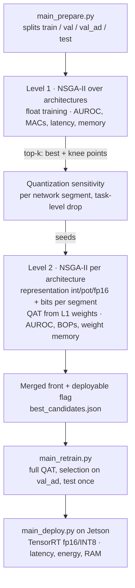

# Hierarchical Architecture + Quantization Search — MVTec AD case study

Case study 1 of a doctoral methodology for **reproducible evaluation and
hierarchical multi-objective optimisation** of neural networks for embedded
robotic systems (NVIDIA Jetson Orin Nano). The optimisation core is
task-agnostic (`src/nas`, `src/tasks`); MVTec AD anomaly detection is the
first task plugged into it. Reinforcement-learning policies are meant to plug
into the same core through the same task interface.

## Methodology



- **Level 1 — architecture.** `family, input_size, depth, base_width,
  width_mult, kernel_size, layer_type, expansion, bottleneck_dim, use_skip`
  (the fields of `ArchSpec` in `src/models/model_factory.py`).
- **Level 2 — numeric representation.** `int` (uniform), `pot`
  (power-of-two weights, shift-only multiplies), `fp16`; 2-bit weights are
  ternary `{-1, 0, +1}` with abs-mean scale (BitNet b1.58); symmetric /
  asymmetric; per-channel; weight and activation bits per **segment** (the
  ordered Conv/Linear layers split into contiguous parts — works for CNNs and
  MLP policies alike).
- **Level 3 — hardware.** TensorRT executes only fp16 and symmetric INT8
  convolutions, so every final solution carries a `deployable` flag and at
  least one deployable model is always handed to the Jetson.
- **Objectives.** Configurable per level by name. Latency / energy of
  fake-quantized models on a desktop GPU are meaningless (fake-quant runs in
  fp32), so Level 2 optimises deterministic **BOPs** (`MACs × w_bits ×
  a_bits`) and weight memory; latency and energy of finalists are measured on
  the Jetson. The development PC's RTX 3050 does not report power through
  NVML, hence `energy_backend: none` there (the evaluator refuses to start
  with a backend that cannot measure).
- **Baselines for the analysis.** `--mode flat` (one joint NSGA-II, no
  hierarchy) and `--mode random` use the same task, evaluator and final
  objectives, so fronts are directly comparable (hypervolume per generation
  in every `history.csv`).

## Data protocol

`main_prepare.py` builds deterministic splits per category (`crc32` seeds):
`train` / `val` (normal images only, for the training loss) from
`train/good`, and the official test set split **30 % `val_ad` / 70 % `test`**
stratified by defect type. The search, checkpoint ranking and model selection
use `val_ad`; `test` is evaluated once, in `main_retrain.py`, for the report.
The task refuses `eval_split: test`.

## Usage

```bash
# environment used for the experiments: Python 3.13, torch 2.6 + CUDA 12.4
pip install -r requirements.txt

python main_prepare.py --archive mvtec_anomaly_detection.tar.xz
python test_hierarchical.py                      # self-checks, no GPU needed

python main_hierarchical.py --config config/hierarchical.yaml            # hierarchical
python main_hierarchical.py --config config/hierarchical.yaml --mode flat
python main_hierarchical.py --config config/hierarchical.yaml --mode random --seed 1

python main_retrain.py --config config/retrain.yaml     # full QAT of best_candidates.json
python main_deploy.py  --config config/deploy.yaml      # on the Jetson
```

Outputs: `results/hierarchical/<category>/<mode>_seed<seed>/` with
`run_config.json` (config, git commit, environment), per level
`evaluations.csv`, `history.csv`, `pareto.csv`, per Level-2 architecture
`sensitivity.json`, and `final_front.csv`, `best_candidates.json`,
`run_summary.json` (evaluations and GPU time per level).

## Layout

```
config/            hierarchical.yaml, retrain.yaml, deploy.yaml, report.yaml, tracking.yaml
main_prepare.py    splits + dataset validation + system info
main_hierarchical.py  Level 1 -> sensitivity -> Level 2 -> hand-off (or flat / random)
main_retrain.py    full-budget QAT of the hand-off candidates
main_deploy.py     ONNX -> TensorRT, on-device latency / energy / RAM
main_tracking.py   closed-loop perceptual tracking (camera -> detector -> PID)
main_report.py     figures and tables
src/nas/           space.py (genes), nsga2_engine.py, fitness.py (generic), pareto.py
src/tasks/         mvtec.py — the task interface (build/train/calibrate/evaluate)
src/quantization/  qat_wrapper.py (int / pot / ternary / fp16), quant_error.py
src/profiling/     complexity.py (MACs/BOPs), latency / RAM / energy meters
```

## Known limitations

- `feature_recon` and `student_teacher` families need a pretrained teacher that
  the training loop does not provide; they are excluded from the search space.
- `main_report.py` still reads the old `results/search` layout and has not been
  adapted to the hierarchical outputs yet.
- Results produced before October 2026 (`results/search`, `results/retrain`)
  are invalid: the genome never reached the model (every candidate was the
  default autoencoder), quantization was never applied in retraining, and
  the search selected on the test set.
